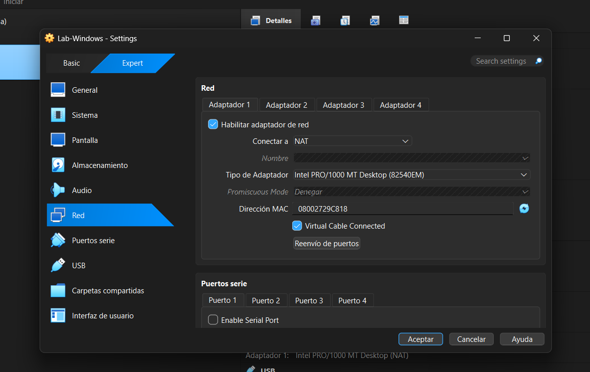
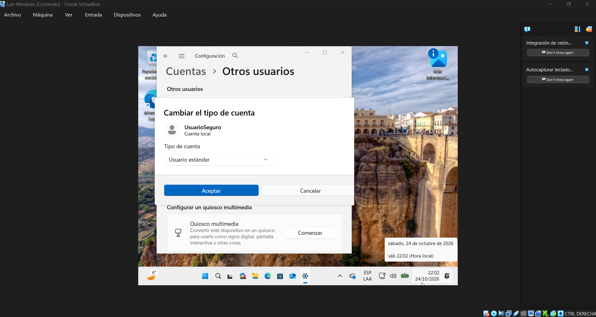
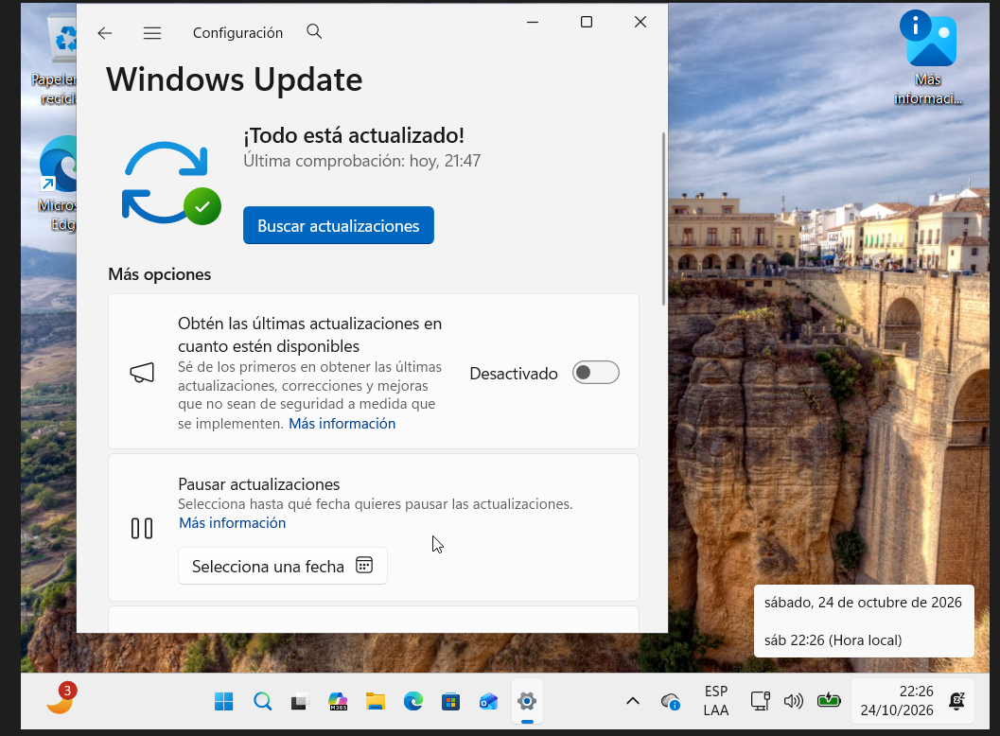
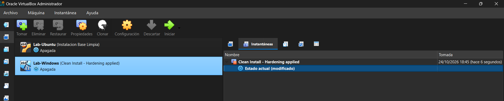

# Mi primer laboratorio seguro de ciberseguridad

**Alumna:** Gisela Tomei  
**Curso:** Ciberseguridad - Coderhouse  
**Sistema elegido:** Windows 11 Pro  
**Máquina virtual:** Lab-Windows  
**Programa utilizado:** VirtualBox  

## Objetivo

Preparé una máquina virtual con Windows para realizar las prácticas del curso. Configuré la red en modo NAT, creé un usuario estándar, actualicé el sistema y guardé una instantánea para poder volver a este estado si algo sale mal.

## 1. Configuración de red

Comprobé que el adaptador de red de Lab-Windows estuviera configurado en modo NAT.

Elegí este modo porque permite que la máquina virtual acceda a Internet para descargar actualizaciones, sin aparecer como otro equipo conectado directamente a la red de mi casa. Además, las conexiones entrantes hacia la VM no quedan habilitadas de forma predeterminada.

Esto reduce su exposición, aunque NAT no significa que la máquina virtual esté completamente aislada del equipo real.

## 2. Usuario estándar para las prácticas

Creé una cuenta local llamada UsuarioSeguro y comprobé que fuera de tipo Usuario estándar. Conservé la cuenta inicial para las tareas de administración.

Usaría UsuarioSeguro para las prácticas diarias y las credenciales de administrador solo cuando fueran necesarias. Así aplico el principio de menor privilegio: usar únicamente los permisos que necesito.

## 3. Actualizaciones de Windows

Entré en Windows Update, descargué e instalé las actualizaciones disponibles y reinicié la máquina virtual cuando el sistema lo solicitó.

Después del reinicio, Windows Update mostró el mensaje “¡Todo está actualizado!”.

Mantener Windows actualizado ayuda a corregir fallas de seguridad conocidas y reduce el riesgo de que sean aprovechadas para atacar el sistema.

## 4. Instantánea inicial

Con la máquina virtual apagada, creé una instantánea llamada:

**Clean Install - Hardening applied**

En la descripción indiqué “Hardening Inicial” y las medidas aplicadas: usuario estándar creado, Windows actualizado y SMB 1.0 desactivado.

Esta instantánea guarda un punto de referencia al que puedo volver si una práctica provoca errores o cambios que necesito deshacer.

## Reflexión final

Con esta actividad aprendí a preparar un entorno de prácticas con medidas básicas de seguridad. Usar una máquina virtual, limitar los permisos, mantener el sistema actualizado y guardar una instantánea me permite trabajar de forma más controlada y recuperar el estado anterior si lo necesito.
